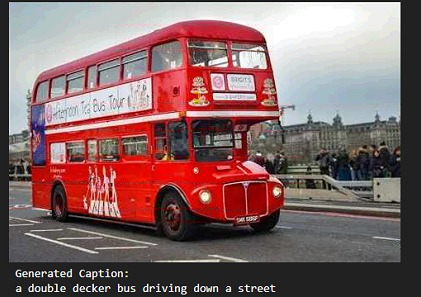

# Image Captioning Using Deep Learning

[](https://pytorch.org/)
[](https://pytorch.org/vision/)
[](https://www.python.org/)
[](LICENSE)

An end-to-end deep learning framework that automatically generates natural language captions for visual scenes. Built using a **Show and Tell** encoder-decoder architecture in PyTorch, this project integrates a transfer-learned **VGG16** Convolutional Neural Network as a vision backbone with an autoregressive **Long Short-Term Memory (LSTM)** network as a language decoder, trained and evaluated on the **Mini COCO 2014** dataset.

---

## Table of Contents

- [Project Overview](#project-overview)
- [Objectives](#objectives)
- [Model Architecture and Workflow](#model-architecture-and-workflow)
- [Technologies and Libraries Used](#technologies-and-libraries-used)
- [Dataset Description](#dataset-description)
- [Data Preprocessing](#data-preprocessing)
- [Model Training](#model-training)
- [Inference and Caption Generation](#inference-and-caption-generation)
- [Experimental Results](#experimental-results)
- [Example Inference and Project Visual](#example-inference-and-project-visual)
- [Project Structure](#project-structure)
- [Installation and Setup](#installation-and-setup)
- [How to Run the Notebook](#how-to-run-the-notebook)
- [Limitations and Future Improvements](#limitations-and-future-improvements)
- [Author and GitHub Repository](#author-and-github-repository)

---

## Project Overview

Image captioning is a fundamental multimodal challenge at the intersection of **Computer Vision (CV)** and **Natural Language Processing (NLP)**. The objective is to analyze an input image and generate a coherent, contextually accurate descriptive sentence.

This project implements the seminal **Show and Tell: A Neural Image Caption Generator** paradigm using PyTorch. By decoupling feature extraction from language generation, high-level spatial visual representations are extracted using a pre-trained **VGG16** network and translated into syntactic sequences using a sequence-to-sequence LSTM decoder.

---

## Objectives

1. **Multimodal Alignment**: Bridge visual concepts with textual descriptions by projecting deep visual embeddings into the language representation space.
2. **Efficient Feature Caching**: Accelerate model training by precomputing and caching 4096-dimensional VGG16 features for all training and validation images.
3. **Robust Sequence Generation**: Build a recurrent language model with dropout regularization and gradient clipping to avoid vanishing/exploding gradients.
4. **Rigorous Quantitative Evaluation**: Benchmark caption quality across standard evaluation metrics (BLEU-1 through BLEU-4) against human reference annotations.
5. **Interactive Inference**: Provide an intuitive interface allowing users to upload novel images and inspect generated captions in real time.

---

## Model Architecture and Workflow

The system adopts an **Encoder-Decoder** design pattern:

```
[ Input Image (224x224x3) ]
             │
             ▼
┌─────────────────────────┐
│ Pretrained VGG16 CNN    │  (Feature Extractor: Frozen weights)
│ Layer: Classifier[0:5]  │
└─────────────────────────┘
             │
             ▼ 4096-d Feature Vector
┌─────────────────────────┐
│ Linear Image Projection │  (4096 -> 512)
└─────────────────────────┘
             │
             ▼ 512-d Visual Embedding Token
┌─────────────────────────┐      ┌─────────────────────────┐
│ Visual Token (t=0)      │ ───► │ Word Embedding (t=1..T) │
└─────────────────────────┘      └─────────────────────────┘
             │                                │
             └───────────────┬────────────────┘
                             │
                             ▼
              ┌─────────────────────────────┐
              │  LSTM Decoder (Hidden=512)  │
              │  Dropout (p=0.3)            │
              └─────────────────────────────┘
                             │
                             ▼
              ┌─────────────────────────────┐
              │  Linear Classifier (Head)   │  (512 -> Vocab Size: 4,338)
              └─────────────────────────────┘
                             │
                             ▼
              [ Predicted Word Tokens / Caption ]
```

### 1. Vision Encoder (VGG16)
- **Backbone**: Pretrained `models.vgg16(weights=VGG16_Weights.DEFAULT)` on ImageNet.
- **Layers**: Convolutional feature extractor, adaptive average pooling, flattening, and the first dense projection layers (`classifier[:5]`).
- **Output**: Fixed 4096-dimensional dense visual feature vector.
- **Freezing**: All encoder weights remain frozen during training (`requires_grad = False`), saving compute and preserving rich semantic representations.

### 2. Decoder Architecture (`ShowAndTellDecoder`)
- **Linear Projection Layer**: Maps 4096-d visual representations into a 512-dimensional embedding space.
- **Word Embedding Layer**: Maps vocabulary indices into 512-dimensional word vectors (`padding_idx=0`).
- **Recurrent Layer (LSTM)**: A single-layer LSTM (`input_size=512`, `hidden_size=512`, `batch_first=True`). At time step $t=0$, the projected image token is passed to initialize semantic context. Subsequent time steps consume word embeddings.
- **Regularization**: Dropout (`p = 0.3`) applied to LSTM hidden states.
- **Projection Head**: Linear layer mapping from hidden dimension (512) to full vocabulary distribution logits (4,338).

---

## Technologies and Libraries Used

| Category | Technologies / Libraries |
|---|---|
| **Deep Learning Framework** | [PyTorch](https://pytorch.org/) (2.11.0+cu128), [Torchvision](https://pytorch.org/vision/) |
| **Image Processing** | [Pillow (PIL)](https://python-pillow.org/) |
| **Scientific Computing** | [NumPy](https://numpy.org/) |
| **Data Visualization** | [Matplotlib](https://matplotlib.org/) |
| **Evaluation Metrics** | [NLTK](https://www.nltk.org/) (`corpus_bleu`, `SmoothingFunction`) |
| **Interactive UI** | [IPyWidgets](https://ipywidgets.readthedocs.io/), IPython Display |
| **Utilities & Progress** | `tqdm`, `json`, `collections` (`Counter`, `defaultdict`), `re` |
| **Hardware Accelerator** | NVIDIA Tesla T4 GPU (Kaggle Cloud Environment) |

---

## Dataset Description

The project utilizes the **Mini COCO 2014 Dataset for Image Captioning** sourced from Kaggle:

- **Source Path**: `/kaggle/input/datasets/nagasai524/mini-coco2014-dataset-for-image-captioning`
- **Annotations**: `captions.json` with multi-reference captions mapped to image IDs.
- **Total Caption Records**: 93,950 captions.
- **Total Matched Images**: 18,783 images.
- **Captions Per Image**: 5 distinct ground-truth reference captions per image.
- **Split Ratio**: 90% Training / 10% Validation (stratified by unique image IDs).
  - **Training Set**: 16,904 images (84,549 image-caption pairs).
  - **Validation Set**: 1,879 images (9,401 image-caption pairs).

---

## Data Preprocessing

### 1. Image Preprocessing Pipeline
Images are transformed to match the ImageNet input distribution expected by VGG16:
- Resized to `(224, 224)` pixels.
- Converted to PyTorch tensors with pixel intensities scaled to $[0.0, 1.0]$.
- Normalized using standard ImageNet parameters:
  $$\mu = [0.485, 0.456, 0.406], \quad \sigma = [0.229, 0.224, 0.225]$$

### 2. Feature Extraction and Offline Caching
- Images were batched (`BATCH_SIZE_FEATURES = 32`) and passed through the frozen VGG16 backbone on a Tesla T4 GPU.
- Total extraction time: **10.5 minutes** for 18,783 images.
- Cached as a single tensor matrix of shape `(18783, 4096)` stored in `mini_coco_vgg16_features.pt` (approx. 293 MB). Caching decouples heavy CNN operations from recurrent decoder training.

### 3. Text Tokenization and Vocabulary Building
- **Tokenization**: Regex-based tokenization `re.findall(r"[a-z]+(?:'[a-z]+)?", sentence.lower())`.
- **Special Tokens**:
  - `<PAD>` (Index 0)
  - `<START>` (Index 1)
  - `<END>` (Index 2)
  - `<UNK>` (Index 3)
- **Thresholding**: Tokens with frequency $\ge 5$ (`MIN_FREQ = 5`) were retained.
- **Vocabulary Size**: 4,338 unique tokens.
- **Sequence Formatting**: Captions truncated/padded to a fixed maximum length (`MAX_LENGTH = 20`):
  $$\text{Input: } [\langle\text{START}\rangle, w_1, w_2, \dots, w_k, \langle\text{END}\rangle, \langle\text{PAD}\rangle, \dots]$$

---

## Model Training

The recurrent decoder was trained on the precomputed feature vectors:

- **Loss Function**: `nn.CrossEntropyLoss(ignore_index=PAD_ID)`
- **Optimizer**: `torch.optim.Adam` with learning rate $\eta = 0.001$ (`1e-3`)
- **Regularization**: Dropout ($p=0.3$) and gradient norm clipping at $5.0$ (`torch.nn.utils.clip_grad_norm_`)
- **Batch Size**: 256
- **Epochs**: 5

### Training Loss Progression

| Epoch | Training Loss | Validation Loss | Checkpoint Status |
|:---:|:---:|:---:|:---:|
| **1** | 3.9310 | 3.2486 | Saved (`best_val_loss = 3.2486`) |
| **2** | 3.0851 | 2.8837 | Saved (`best_val_loss = 2.8837`) |
| **3** | 2.8089 | 2.7355 | Saved (`best_val_loss = 2.7355`) |
| **4** | 2.6532 | 2.6615 | Saved (`best_val_loss = 2.6615`) |
| **5** | 2.5419 | **2.6166** | Saved (`best_val_loss = 2.6166`) |

The optimal checkpoint was preserved as `show_and_tell_pytorch_corrected.pth` (file size: approx. 33 MB).

---

## Inference and Caption Generation

Caption generation utilizes an **autoregressive greedy decoding** strategy:

1. An input image is preprocessed and passed through the VGG16 feature extractor to generate a 4096-d feature vector.
2. The vector is linearly projected to dimension 512 and passed into the LSTM as the initial time step $t=0$.
3. At each time step $t \ge 1$:
   - The LSTM computes the hidden state $h_t$ and cell state $c_t$.
   - The linear classification head computes logits over the 4,338-word vocabulary.
   - The index with the highest logit ($\text{argmax}$) is selected as the next token.
   - If the predicted token is `"<END>"`, decoding terminates.
   - Otherwise, the word embedding of the predicted token is fed into the LSTM for step $t+1$.
4. The generated token indices are mapped back to English words and formatted into a fluent caption.

---

## Experimental Results

The trained model was evaluated against multi-reference human captions using the standard **Bilingual Evaluation Understudy (BLEU)** n-gram precision metric with Chen & Cherry smoothing (`SmoothingFunction().method1` via `nltk.translate.bleu_score`).

### Quantitative Results

| Evaluation Metric | Score |
|---|---:|
| **BLEU-1** | **0.6571 (65.71%)** |
| **BLEU-2** | **0.4766 (47.66%)** |
| **BLEU-3** | **0.3432 (34.32%)** |
| **BLEU-4** | **0.2526 (25.26%)** |
| **Images evaluated** | **100** |

### Analysis of Evaluation Scores
- **BLEU-1 (65.71%)**: Demonstrates high unigram precision, confirming that the model accurately detects core visual entities (e.g., *cat*, *airplane*, *motorcycle*, *food*, *plate*).
- **BLEU-2 (47.66%) & BLEU-3 (34.32%)**: Reflect strong bigram and trigram consistency, indicating that entity-action relationships (e.g., *laying on*, *flying through*, *riding a*) are well-preserved.
- **BLEU-4 (25.26%)**: Measures 4-gram phrasal fluency across the 100 evaluated validation images. A BLEU-4 score of 25.26% aligns closely with standard benchmarks for baseline Show and Tell architectures without visual attention mechanisms.

### Qualitative Predictions from the Evaluation Set

| Image ID | Generated Caption | Ground Truth Sample Reference |
|:---:|---|---|
| **425470** | *a cat laying on a bed with a blanket on it* | *A cat laying comfortably on someone's bed with red sheets* |
| **114464** | *a large airplane flying through the sky above a cloudy sky* | *Near an amusement park ride, a plane flies high in the blue sky.* |
| **340673** | *a plate of food with a knife on it* | *A slice of chocolate cake and something to drink.* |
| **376972** | *a man riding a motorcycle down a street* | *A man riding on the back of a motor cycle.* |
| **18252** | *a person riding a motorcycle on a dirt road* | *A person that is doing a trick on a motorcycle.* |

---

## Example Inference and Project Visual

Below is a representative sample test image used to demonstrate the model's inference workflow:


*Figure: Sample test image (`bus.jpeg`) utilized to test image captioning inference in the interactive testing pipeline.*

### Interactive Inference Widget
The notebook includes an interactive widget powered by `ipywidgets.FileUpload`:
- Users can click **Choose Image** and select any local image file.
- The image is loaded into memory via `PIL.Image`, transformed, evaluated by the VGG16 feature extractor, and decoded by the LSTM to display an instant caption.

---

## Project Structure

```plaintext
Image-captioning_/
├── assets/
│   └── bus.jpeg                  # Sample input image for inference demonstration
├── bus.jpeg                      # Project sample image in root
├── image-captioning.ipynb        # Complete Jupyter Notebook (data prep, training, eval, inference)
├── requirements.txt              # Project dependencies and libraries
├── .gitignore                    # Exclusions for checkpoints, datasets, and cache files
└── README.md                     # Comprehensive project documentation
```

---

## Installation and Setup

### 1. Clone the Repository
```bash
git clone https://github.com/pamudhurthichaitanya-45/Image-captioning_.git
cd Image-captioning_
```

### 2. Create and Activate a Virtual Environment
```bash
# On Windows
python -m venv venv
venv\Scripts\activate

# On Linux / macOS
python3 -m venv venv
source venv/bin/activate
```

### 3. Install Dependencies
```bash
pip install -r requirements.txt
```

---

## How to Run the Notebook

1. **Launch Jupyter Notebook or JupyterLab**:
   ```bash
   jupyter notebook image-captioning.ipynb
   ```
2. **Kaggle Environment (Recommended for GPU training)**:
   - Create a new notebook on [Kaggle](https://www.kaggle.com/).
   - Add the dataset: `nagasai524/mini-coco2014-dataset-for-image-captioning`.
   - Under notebook **Settings**, set **Accelerator** to **GPU T4 x2** or **GPU P100**.
   - Execute all cells sequentially.
3. **Execution Pipeline**:
   - **Cells 0–3**: Setup environment, load COCO annotations, build vocabulary, and pre-extract VGG16 features.
   - **Cells 4–6**: Instantiate dataset loaders and train the `ShowAndTellDecoder` for 5 epochs.
   - **Cell 7**: Plot training vs. validation loss curve.
   - **Cells 8–9**: Generate sample captions and run corpus BLEU evaluation over 100 validation samples.
   - **Cell 11**: Use the interactive upload widget to test custom local images.

---

## Limitations and Future Improvements

- **Greedy Search vs. Beam Search**: Currently, captions are generated using greedy $\text{argmax}$ decoding. Implementing **Beam Search** with length normalization will improve caption diversity and BLEU-4 scores.
- **Visual Attention Mechanism**: Integrating Bahdanau or Luong spatial attention (e.g., *Show, Attend and Tell*) would allow the decoder to attend to dynamic regions of the image at each timestep.
- **Modern Vision Backbones**: Upgrading from VGG16 to modern vision backbones such as **ResNet-101**, **EfficientNet**, or a **Vision Transformer (ViT)** would provide richer visual representations.
- **Pretrained Language Models / Transformers**: Replacing the LSTM decoder with a Transformer decoder or leveraging multimodal LLMs (e.g., BLIP, LLaVA, or Gemini) for open-ended contextual reasoning.

---

## Author and GitHub Repository

- **Author**: [Pamudhurthi Chaitanya](https://github.com/pamudhurthichaitanya-45)
- **Repository**: [https://github.com/pamudhurthichaitanya-45/Image-captioning_](https://github.com/pamudhurthichaitanya-45/Image-captioning_)
- **Organization**: IIT Internship Project
